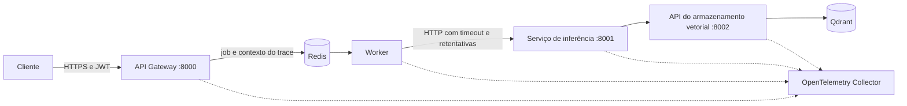

# C3_HOWARD_NUVEM — Plataforma de IA como Serviço

Projeto integrador C3.A2 — FAESA, 2026/2.

Integrantes: Bernardo D'Angelo Leitão, Maria Isabel de Campos Rocha, José Henrique Bessi Wolkers e George Pinheiro Ramos.

Este projeto reúne os serviços desenvolvidos pelo grupo em uma aplicação distribuída. A solução usa um gateway, uma fila de tarefas, um worker, um serviço de inferência e um armazenamento vetorial. A chamada a um modelo de IA é opcional e feita por API; não há treinamento de modelos.

**Situação atual:** os arquivos da aplicação e do Docker Compose estão no repositório, mas a stack ainda precisa ser executada e testada em um computador com Docker. O deploy público também está pendente. A URL será informada aqui depois de a publicação e o HTTPS serem verificados.

## Arquitetura



O gateway recebe as requisições e publica os jobs no Redis. O worker processa a fila e chama o serviço de inferência. A inferência consulta o serviço de armazenamento vetorial e, se `OPENAI_API_KEY` estiver configurada, pode chamar uma API de IA externa.

Há um Dockerfile para cada serviço próprio: gateway, inferência, worker e vectorstore. Redis, Qdrant, OpenTelemetry Collector e Caddy são usados como imagens de terceiros no Compose.

## Como executar localmente

É necessário Docker Engine ou Docker Desktop com Docker Compose v2. Na raiz do repositório:

```bash
cp .env.example .env
```

Edite `.env` antes de subir a aplicação. Defina um `JWT_SECRET` aleatório e uma senha própria em `DEMO_PASSWORD`. Não publique esse arquivo nem use os valores de exemplo em uma máquina acessível pela rede.

```bash
docker compose up --build -d
docker compose ps
```

O gateway local fica em `http://localhost:8000`; a documentação da API fica em `/docs` e o endpoint de saúde é `/saude`. Para consultar logs:

```bash
docker compose logs -f gateway worker inference vectorstore
```

Para parar os serviços, sem apagar os volumes:

```bash
docker compose down
```

Para apagar também os dados persistidos no Redis e no Qdrant:

```bash
docker compose down -v
```

## Uso da API

O login de demonstração recebe o usuário e a senha configurados no `.env` e retorna um JWT:

```bash
curl -X POST http://localhost:8000/auth/login \
  -H 'Content-Type: application/json' \
  -d '{"username":"aluno","password":"SUA_SENHA"}'
```

Use o token retornado para enviar um job:

```bash
curl -X POST http://localhost:8000/v1/jobs \
  -H 'Authorization: Bearer SEU_TOKEN' \
  -H 'Content-Type: application/json' \
  -d '{"text":"Explique o teorema CAP"}'
```

A resposta inclui um `job_id`. Consulte `GET /v1/jobs/{job_id}` com o mesmo token para acompanhar o processamento e obter o resultado.

Rotas principais:

- `POST /auth/login`: autenticação de demonstração e emissão de JWT.
- `GET /saude`: verificação de disponibilidade do gateway.
- `POST /v1/jobs`: envio de um job; exige JWT e responde com HTTP 202.
- `GET /v1/jobs/{job_id}`: consulta do job; exige JWT e verifica se ele pertence ao usuário autenticado.

O gateway aplica um limite de 60 chamadas por minuto por IP, mantido em memória no processo. Os serviços internos não publicam portas próprias no host; o gateway é a entrada da aplicação.

## Resiliência e observabilidade

As chamadas do worker ao serviço de inferência têm timeout de até 20 segundos (3 segundos para conexão), até quatro tentativas e espera progressiva limitada a 1, 2 e 4 segundos. O circuit breaker abre após cinco falhas, bloqueia chamadas por 20 segundos e depois permite novas tentativas.

Os estados dos jobs ficam no Redis. O contexto de rastreamento é enviado junto com a mensagem da fila, para relacionar spans do gateway, do worker e das chamadas seguintes. O OpenTelemetry Collector recebe os traces e os mostra nos logs:

```bash
docker compose logs -f otel-collector
```

Nesta configuração não há armazenamento persistente nem painel para consultar traces. O rate limit e o circuit breaker mantêm estado em memória. O worker usa `BRPOP`; se o processo parar depois de retirar uma mensagem e antes de salvar o resultado, o job pode não ser reprocessado automaticamente. A recuperação de mensagens com Redis Streams ou outra fila com confirmação não está implementada.

## Segurança e LGPD

**Dados tratados:** usuário de demonstração, IP usado pelo rate limit, texto enviado no job, resposta e dados de estado do job no Redis, além dos textos indexados no Qdrant.

**Finalidade:** autenticar o usuário, controlar a frequência de chamadas, processar a solicitação e recuperar contexto para a resposta. Se `OPENAI_API_KEY` for configurada, o texto e o contexto necessário podem ser enviados ao provedor indicado em `OPENAI_BASE_URL`.

**Retenção:** o JWT expira após 60 minutos por padrão; os dados do rate limit ficam em memória por janela de 60 segundos. Jobs e documentos permanecem nos volumes do Redis e do Qdrant até serem removidos. Não há expiração automática configurada. `docker compose down -v` remove os volumes locais. Antes de usar dados reais, o grupo precisa definir um prazo de retenção e um procedimento de exclusão.

O segredo JWT e a senha ficam no `.env`, que não deve ser versionado. A autenticação por senha única de demonstração não é adequada para usuários reais. Não use dados pessoais ou sensíveis na demonstração. Em uma publicação, o acesso deve ser feito por HTTPS; a política e a região de processamento do provedor de IA também devem ser verificadas antes de enviar dados.

## Publicação com HTTPS

O perfil `public` inicia o Caddy, que pode solicitar e renovar um certificado TLS quando `PUBLIC_DOMAIN` aponta para um domínio válido e as portas 80 e 443 estão abertas para a máquina. É necessário configurar DNS, firewall e as variáveis do `.env` antes de executar:

```bash
docker compose --profile public up --build -d
```

O guia está em [`docs/GUIA.md`](docs/GUIA.md). **Ainda não há publicação nem URL pública validada.** Depois do deploy, teste o endpoint de saúde e o fluxo de jobs pela URL HTTPS e registre o endereço real nesta seção. No perfil público, também é necessário impedir o acesso externo direto à porta 8000 do gateway, para que o tráfego não contorne o Caddy.

**URL pública:** pendente de publicação e teste.

## Trade-offs

**CAP e consistência:** o Redis é necessário para submeter e acompanhar jobs; se estiver indisponível, essas operações também ficam indisponíveis. A busca vetorial usa uma instância única do Qdrant, sem replicação. A atualização do índice pode não aparecer imediatamente nas consultas.

**Custo:** a execução local e o modo sem chave de IA não geram custo de inferência externa. Redis, Qdrant e OpenTelemetry consomem recursos da máquina. A disponibilidade e os limites de um plano gratuito dependem do provedor. A API externa pode cobrar por uso.

**Latência:** o envio do job retorna antes do processamento terminar. O tempo total depende da fila, da busca vetorial e, quando habilitada, da API externa. Retentativas podem aumentar o tempo de resposta final.

## Testes e pendências para a entrega

Os testes automatizados podem ser executados assim:

```bash
python -m pip install -r requirements-dev.txt
pytest -q
python -m compileall -q services tests
```

Os testes automatizados não substituem a validação integrada com Docker. Antes da entrega, falta:

- [ ] Executar `docker compose up --build -d` em um host com Docker Compose v2 e confirmar que todos os serviços iniciam.
- [ ] Testar o fluxo completo: login, envio do job, consumo pelo worker, inferência e consulta do resultado.
- [ ] Verificar a propagação de um trace do gateway pela fila até o worker e os serviços chamados.
- [ ] Testar o timeout, as retentativas e o circuit breaker diante de falhas controladas.
- [ ] Publicar a aplicação em um plano gratuito compatível, testar o acesso por HTTPS e registrar a URL pública real.
- [ ] No ambiente publicado, bloquear o acesso externo direto à porta 8000 e confirmar que a entrada ocorre pelo Caddy/HTTPS.
- [ ] Definir o prazo de retenção e o procedimento de exclusão de jobs e documentos antes de usar dados reais.

O grupo também deve considerar a possibilidade de perda de um job após uma falha abrupta do worker. A implementação atual não usa confirmação e recuperação de mensagens com Redis Streams; essa limitação precisa ser testada e descrita, ou corrigida.

## Referências

- Kit oficial C3.A2: https://github.com/howardroatti/sd-2026-2-kit-c3a2
- Repositório das atividades: https://github.com/bessiwolkers-droid/HOWARD_NUVEM
- Projeto C2.A2: https://github.com/bessiwolkers-droid/C2_HOWARD_NUVEM
